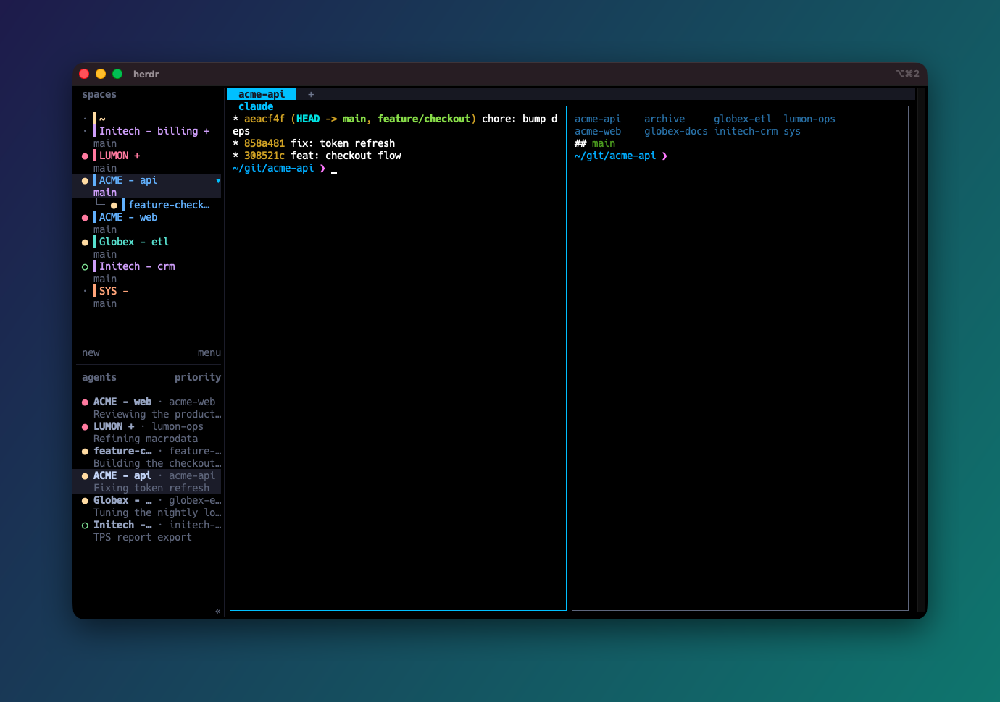
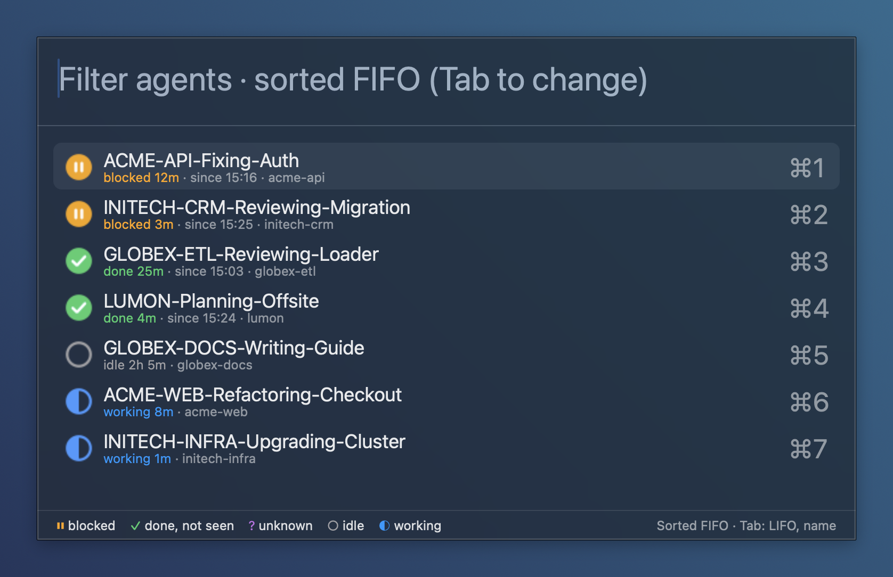
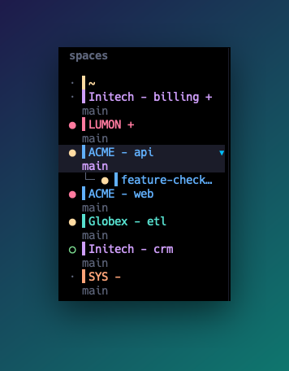
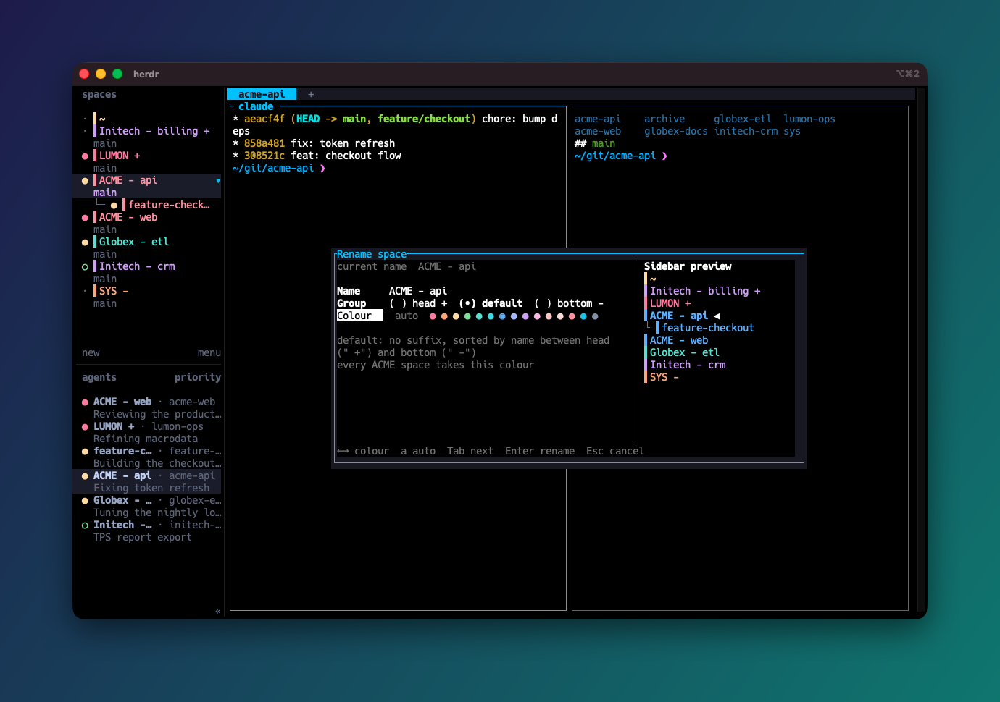

# herdr-tools

[](https://github.com/MrBogomips/herdr-tools/actions/workflows/test.yml)
[](LICENSE)
[](https://herdr.dev)

Plugins for the [Herdr](https://herdr.dev) terminal multiplexer, for people who keep a lot of
spaces open: one per customer, project and side quest. Each tool installs and works on its own:
none needs another, so take only the ones you want.

**Website: [mrbogomips.github.io/herdr-tools](https://mrbogomips.github.io/herdr-tools/)**, where
you can paste your own space names and watch Space Herder sort and colour them.



<sub>Herdr with Space Herder and auto-tab-name, on fictional customers.</sub>

## What you get

- **A sidebar that sorts itself.** [Space Herder](space-herder/) keeps `~` first, pins
  `LUMON +` on top, parks `SYS -` at the bottom and puts everything else in name order, every time
  a space is created or renamed.
- **A colour per customer.** It paints every space of one customer in the same colour:
  `ACME - api`, `ACME - web` and their worktrees in blue, Initech in mauve. Pick a Catppuccin,
  Dracula, Nord or Tokyo Night palette, and colours stay apart as customers come and go.
- **New and rename dialogs that show the result.** Type a name and watch the sidebar preview: the
  space slides into its group and takes its customer's colour before you press Enter. Pick another
  colour and every space of that customer follows.
- **Tabs that name themselves.** [auto-tab-name](auto-tab-name/) names each tab after its folder,
  repo or branch, and follows your agents into worktrees.
- **Your agents, one key away.** [herdr-jump](herdr-jump/) lists the agents waiting for you, from
  any macOS app. It needs only a running Herdr: no plugin, these included, and nothing to set up
  inside Herdr.


<sub>A new space from start to finish: folder, name, group, colour, Enter.</sub>

## Plugins

| Plugin | What it does | Install |
| --- | --- | --- |
| [auto-tab-name](auto-tab-name/) | Names each tab after the folder of its pane (folder, repo, path or branch) and keeps it in sync as you and your agents move around (into a worktree, say); tabs you rename by hand are left alone | `herdr plugin install MrBogomips/herdr-tools/auto-tab-name` |
| [space-herder](space-herder/) | Herds the spaces sidebar: sorts it into `~`, head (`+`), default and bottom (`-`) groups, then by name, on a key or by itself when a space is created or renamed; colours each space name by its customer prefix (stable hash or sticky least-used colour, or regex rules) from a preset palette such as Catppuccin or Dracula (up to 15 colours); new-space and rename dialogs preview the name, group, place and colour, and let you pick the colour | `herdr plugin install MrBogomips/herdr-tools/space-herder` |

### Companions

Tools that work with Herdr from outside it. They are not plugins: `herdr plugin install` does not
handle them and the marketplace does not list them; each README explains its install.

| Companion | What it does | Runs in |
| --- | --- | --- |
| [herdr-jump](herdr-jump/) | From any macOS app: one key back to your terminal, one key to a Spotlight-style list of your agents (blocked first, then done, oldest wait first, with how long each has waited), and a menu bar icon that counts the agents waiting for you. Standalone: it needs only the Herdr server, no plugin. Installed with one line of `curl` piped to `sh` | [Hammerspoon](https://www.hammerspoon.org) |



herdr-jump's picker, with fictional agents: every agent that waits for you, in the order it
started waiting, one key away from any app.

## A naming scheme



Name spaces `CUSTOMER - project`, mark the ones you always want on top with ` +` and the parking
lot with ` -`:

- `~` is home, always first.
- `Initech - billing +` and `LUMON +` form the head group, always on top.
- `ACME - api` and `ACME - web` share one colour (Space Herder keys on `ACME`) and sit side by
  side (names sort alphabetically); the `feature-checkout` worktree follows its parent.
- `SYS -` is in the bottom group, out of the way.

With Space Herder's `"auto_sort": "both"` and `"assign": "sticky"`, a new or renamed space lands
in its place with its customer's colour, with no key to press; customers keep apart colours as
long as there are fewer of them than colours (15 at most).

To learn the scheme as you go, bind the [new-space and rename dialogs](space-herder/#dialogs) in
place of Herdr's own prompts: they preview the group a suffix picks and where the space lands,
and let you pick the customer's colour.

<br clear="right">



<sub>Renaming `ACME - api`: picking blue recolours every ACME space in the preview at once.</sub>

## Install

Every plugin lives in its own folder with its manifest (`herdr-plugin.toml`), code, tests and
README. Herdr installs a single folder of a GitHub repository:

```bash
herdr plugin install MrBogomips/herdr-tools/<plugin>   # one plugin
herdr plugin update                                    # update installed plugins
herdr plugin uninstall mrbogomips.<plugin>             # remove one
```

Herdr shows the manifest and the commands it will run before installing. Plugins are ordinary
code running as your user, so read them first; these are short Python scripts.

Each plugin's README explains its key bindings and its `config.json`, which lives in
`herdr plugin config-dir <plugin id>`.

### Requirements and compatibility

| | Plugins (auto-tab-name, Space Herder) | herdr-jump |
| --- | --- | --- |
| System | macOS or Linux | macOS |
| Herdr | 0.9.5 or newer | 0.9.5 or newer, on the same Mac |
| Other herdr-tools | none: each plugin works alone | none: it reads the Herdr server only, with or without plugins |
| Runs on | `python3` 3.9 or newer, standard library only | [Hammerspoon](https://www.hammerspoon.org) (verified with 1.1.1) |
| Shell | none needed; auto-tab-name's optional shell integration covers zsh, bash and fish | none needed; `install.sh` runs in `sh` |
| Terminal | any; Space Herder's colours need truecolor, auto-tab-name's `alt` keys need Option as Alt | any: iTerm2 and Terminal get the exact tab, other terminals come forward as an app |
| Also | nothing else to install | Homebrew only to install Hammerspoon; the Accessibility and Automation permissions |

About `python3`:

- Herdr runs the first `python3` on the `PATH` its server started with, from 3.9 to the latest
  (CI tests 3.9, 3.13 and 3.14). On macOS, `/usr/bin/python3` works once the Command Line Tools are
  installed (`xcode-select --install`); Python from Homebrew or python.org works too.
- The server keeps that `PATH` until it restarts: after installing Python, run `herdr server stop`
  (it ends the programs running in its panes) and start `herdr` again.

Not covered: Windows (the plugins use POSIX modules), and for herdr-jump a Herdr client inside
tmux or over ssh, whose terminal cannot be seen: its keys then bring forward a default terminal.
`herdr-jump/install.sh --check` tells what a Mac has and lacks for herdr-jump.

### Versions

`herdr plugin update` follows `main`, which only receives tested changes. Every release is also
tagged `<plugin>-vX.Y.Z` (for example `auto-tab-name-v0.3.0`); to stay on one, pin it:

```bash
herdr plugin install MrBogomips/herdr-tools/auto-tab-name --ref auto-tab-name-v0.3.0
```

## Develop

```bash
git clone https://github.com/MrBogomips/herdr-tools
herdr plugin link "$PWD/herdr-tools/space-herder"   # run your working copy
cd herdr-tools/space-herder && /usr/bin/python3 -m unittest -v
```

- One folder per plugin: `herdr-plugin.toml`, `README.md`, `config.example.json`, the code and
  its `test_*.py` next to it. Plugin ids are `mrbogomips.<folder>`.
- `herdr_api.py` (socket client, config loading, locking, toasts) is copied into every plugin so
  each one installs alone. Edit it in one plugin and copy it to the others; CI fails while the
  copies differ.
- Code stays compatible with Python 3.9 (`/usr/bin/python3` on macOS) and uses the standard
  library only. CI runs every plugin's tests on macOS with the system Python and with Python 3.13
  and 3.14, and on Ubuntu.
- Manifest commands run `python3 -E -X utf8 <script>`: whatever `python3` Herdr finds, the user's
  `PYTHON*` variables cannot hide the plugin's modules and the I/O stays UTF-8.
- The website is built from [`site/`](site/) with `python3 site/build.py`; its README explains
  the layout and the tests (the playground's parity test needs `node`).
- herdr-jump's tests need Lua 5.4 (`lua herdr-jump/tests/run.lua`, the version Hammerspoon embeds)
  and run its installer under `sh` and `dash` (`sh herdr-jump/tests/test_install.sh`); keep
  `shellcheck -s sh` clean.
- `herdr api schema --json` prints the socket API of your Herdr build; the
  [plugin docs](https://herdr.dev/docs/plugins/) describe manifests, hooks and actions.

## License

[MIT](LICENSE)
