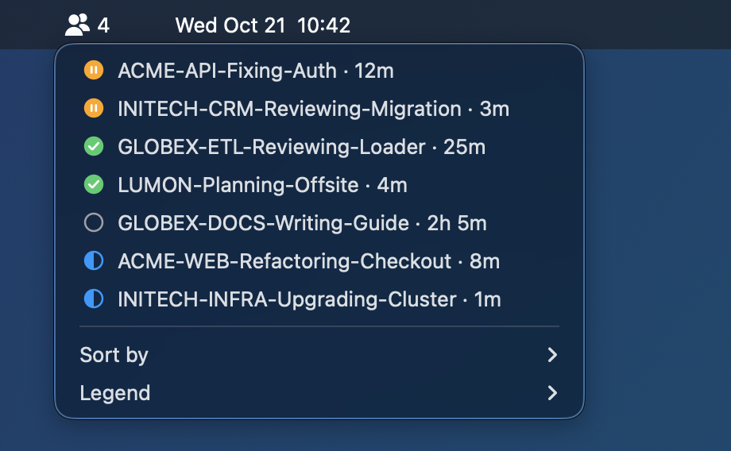

# herdr-jump

A [Hammerspoon](https://www.hammerspoon.org) Spoon for macOS that gets you back to your Herdr
agents from any app: one key back to your terminal, one key to the agent that needs you, and a menu
bar icon that counts the agents waiting for you.

**Website: [herdr-jump at a glance](https://mrbogomips.github.io/herdr-tools/herdr-jump.html)**;
this README is the full reference.

Run five agents at once and they queue up for you: a permission here, a finished review there.
HerdrJump lines them up first come, first served, tells you how long each one has waited, and
takes you to its pane with Enter, whatever app you are in.


The picker (`⌃⌥⌘A`, from any app), with fictional agents: blocked first, then done, each oldest
first; then the others. Tab sorts newest first or by name.

## Standalone

HerdrJump needs only a running Herdr server. No Herdr plugin, from this repository or anywhere
else, and nothing to set up inside Herdr: your config, spaces and tabs stay as they are. It reads
the server with two commands of the `herdr` binary that ships with Herdr, `herdr agent list` every
`pollSeconds` and `herdr agent focus` on a jump (see [How it works](#how-it-works)), so it works
with any Herdr setup, plugins or none. One line installs it, and the next key press switches agents.

It is not a Herdr plugin itself: it runs in Hammerspoon, outside Herdr. It has no
`herdr-plugin.toml`, so the plugin marketplace does not list it.

## Use cases

- **An agent asks for a permission while you are in the browser.** The icon turns solid with a
  count. `⌃⌥⌘A` opens the picker with that agent on top and how long it has waited; Enter lands
  you on its pane, with the terminal window and tab running Herdr in front.
- **Several agents finish while you are in a meeting.** The count says how many. The picker queues
  them oldest first, each with its wait ("done 25m · since 10:40"), so you serve them in turn;
  each one leaves the count once you have looked at it.
- **Following the latest answers instead of the queue.** Tab in the picker sorts newest first
  (LIFO): among the `done` agents, the one that just finished is on top (`blocked` ones still come
  first). Tab again sorts every agent by name. The choice is remembered.
- **Back and forth between your terminal and the app you were in.** `⌃⌥⌘I` brings the terminal
  running Herdr forward on the window you used last, Space or display included; pressed again from
  the terminal, it goes back to the app you came from.
- **A glance instead of a switch.** The icon alone says whether anything waits. Click it for the
  same list as the picker, as a menu.

## Keys

| Key | What happens |
| --- | --- |
| `⌃⌥⌘I` | Activates the terminal running Herdr (see [Terminals](#terminals)). Herdr keeps its focused pane, so you land where you left. From the terminal, goes back to the previous app. |
| `⌃⌥⌘A` | The agents picker, most urgent first: `blocked` (waiting on a permission or a question), `done` (finished, not seen yet), `unknown`, `idle`, `working`; within a status the oldest change first (FIFO). Type to filter by title or folder, Enter to jump: Herdr focuses the agent's pane and the terminal window and tab running the Herdr client come forward. |
| `Tab` (in the picker) | Next sort: FIFO (oldest change first, the default), LIFO (newest first, still by status), name (every agent by title). The filter you typed stays; the choice is remembered. |

Both keys can be changed, see [Configure](#configure).

## Symbols

Each row starts with a colored icon; the status and its time under the title take the same color.
A filled icon waits for you, an outlined one does not. The line at the bottom of the picker is the
legend, with the sort in use and the ones Tab moves to; it is not a row, so it cannot be selected.
The menu bar drop-down has a Legend submenu with the icons.

| Icon | Color | Status |
| --- | --- | --- |
| Disc with pause bars | orange | `blocked`: waiting on a permission or a question |
| Disc with a check mark | green | `done`: finished, not seen yet |
| Ring with `?` | purple | `unknown`: a status HerdrJump does not know (listed, never counted) |
| Empty ring | grey | `idle`, or `done` and already seen |
| Half-filled ring | blue | `working` |

## Waiting times

Herdr reports no times, only counters, so HerdrJump notes when it sees each agent change state and
shows how long ago that was: `12m`, `1h 5m`, `2d 3h`, with the start time for agents that wait for
you (`since 09:41`, `Tue 23:05` within the week). The time is the poll that saw the change, so it
can be up to `pollSeconds` late. `≥12m · since ≤09:41` means the change happened while HerdrJump
could not see it (Hammerspoon was not running, or Herdr did not answer): the agent has waited at
least that long, since that time or earlier.
The times live in Hammerspoon's settings (`HerdrJump.since`) and survive a reload; the queue order
comes from Herdr's own change counter, so it is exact either way.

## Menu bar


| Icon | Meaning |
| --- | --- |
| Two outlined agents | Nothing waits for you |
| Two solid agents and a number | That many agents are `blocked`, or `done` and not seen yet |
| Two outlined agents and `?` | Herdr cannot be read; the menu says why |

Click it for the drop-down: the agents in the picker's order, each with its icon and wait, then
**Sort by** (FIFO, LIFO, by name; the checked one is in use), **Legend** and **Diagnostics** (see
[Troubleshooting](#troubleshooting)).



macOS adds the item left of the other menu bar icons, on the main display. The count can lag by
up to `pollSeconds`.

### Seen agents

Herdr's server marks a `done` agent as seen when something focuses it through the API, as the
picker does. Looking at it inside the Herdr TUI may not, and the count would stay high. So
HerdrJump keeps its own record: a `done` agent counts as seen once it was the focused pane while
the terminal running Herdr was in front. A later completion of the same agent makes it `done` again. The record lives
in Hammerspoon's settings (`HerdrJump.seen`) and survives a reload; an entry whose completion
counter goes backwards (Herdr restarted and reused the pane id) is forgotten.

## Terminals

HerdrJump finds the terminal that runs the Herdr client by itself: it climbs from the client's
process (`ps`) to the app that started it. Nothing to configure for the usual cases.

| Terminal | A jump brings forward |
| --- | --- |
| iTerm2 | the window, tab and session running Herdr (AppleScript, by tty) |
| Terminal | the window and tab running Herdr (AppleScript, by tty) |
| Any other app: Ghostty, WezTerm, kitty, Alacritty, Warp, VS Code… | the app, on its last used window |

- A client inside tmux, screen or zellij, or reached over ssh, hides its terminal: the keys bring
  forward `terminalBundleID` (by default iTerm2 when installed, else Terminal), and Diagnostics
  says why.
- An iTerm2 restart can leave its shells under an `iTermServer` process that no longer belongs to
  iTerm2: HerdrJump still takes it for iTerm2.
- A client of a named session (`herdr --session <name>`) counts when `socketPath` is that session's
  socket; with no client of it in sight, every client counts.

## Install

Requirements: macOS, Herdr 0.9.5 or newer in a terminal (see [Terminals](#terminals)), and
Homebrew if [Hammerspoon](https://github.com/Hammerspoon/hammerspoon) (MIT) is not installed yet.

Paste into a terminal:

```bash
curl -fsSL https://raw.githubusercontent.com/MrBogomips/herdr-tools/main/herdr-jump/install.sh | sh
```

The script asks nothing and prints what it does:

- installs Hammerspoon with Homebrew when it is missing;
- downloads `HerdrJump.spoon` from this repository into the `Spoons` folder of Hammerspoon's
  config (`~/.hammerspoon/Spoons`, or beside the `init.lua` that Hammerspoon's `MJConfigFile`
  setting names), replacing the previous copy: the same line updates it;
- creates `init.lua` from [`init.example.lua`](init.example.lua) when you have none (it also turns
  off Hammerspoon's crash reporting, starts it at login and hides its Dock icon), or appends the
  HerdrJump lines to yours. Either way it adds `herdrBin`, the `herdr` your shell runs, and
  `socketPath` when `herdr status server` names another socket than the default: Hammerspoon sees
  neither your `PATH` nor `XDG_CONFIG_HOME` or `HERDR_SESSION`. An `init.lua` that loads HerdrJump
  already is left as it is;
- reloads Hammerspoon, or starts it.

To see what HerdrJump needs and what it finds, on a Mac with or without it, changing nothing:

```bash
curl -fsSL https://raw.githubusercontent.com/MrBogomips/herdr-tools/main/herdr-jump/install.sh | sh -s -- --check
```

It checks Hammerspoon, `init.lua` and the Spoon, `herdr` and its version, the server socket and
the installed terminals, then prints the running HerdrJump's own Diagnostics through the `hs`
command line. It exits 1 when Hammerspoon or `herdr` is missing.

To read the script first, or to install a branch or a release tag (`herdr-jump-vX.Y.Z`, when one
has been cut) instead of `main`:

```bash
curl -fsSL https://raw.githubusercontent.com/MrBogomips/herdr-tools/main/herdr-jump/install.sh -o install.sh
less install.sh
sh install.sh --ref <branch-or-tag>
```

From a clone, `ln -s "$PWD/herdr-jump/HerdrJump.spoon" ~/.hammerspoon/Spoons/HerdrJump.spoon`
follows your checkout instead; the script leaves such a link alone unless you pass `--force`.

macOS asks for two permissions:

- **Accessibility** for Hammerspoon, on first launch: global hotkeys need it.
- **Automation: Hammerspoon → iTerm2, or → Terminal**, on the first jump: selecting the Herdr tab
  uses the terminal's AppleScript. Without it, a jump still focuses the agent and activates the
  terminal, but cannot pick the window when you have several; an alert points to System Settings ›
  Privacy & Security › Automation, and so does Diagnostics.

To remove HerdrJump, delete `HerdrJump.spoon` from Hammerspoon's `Spoons` folder and its lines in
`init.lua`, then reload Hammerspoon.

## Configure

Set these before `start()`:

| Setting | Default | Meaning |
| --- | --- | --- |
| `herdrBin` | found | The `herdr` binary. Unset or missing, it is looked for in `/opt/homebrew/bin`, `/usr/local/bin`, `~/.local/bin` (Herdr's installer), `~/.cargo/bin`, the Nix profiles, `/opt/local/bin` and mise's shims: Hammerspoon's PATH has none of them |
| `socketPath` | `~/.config/herdr/herdr.sock` | The Herdr server socket, passed as `HERDR_SOCKET_PATH`: set it when your Herdr uses another one (`herdr status server` prints it), such as a named session's `~/.config/herdr/sessions/<name>/herdr.sock` |
| `terminalBundleID` | iTerm2 when installed, else Terminal | The terminal to bring forward when no Herdr client shows its own (Herdr in tmux, or not running); `itermBundleID`, its former name, still works |
| `pollSeconds` | `5` | How often the agent list is read |
| `showMenubar` | `true` | Show the menu bar icon and count |
| `defaultOrder` | `"fifo"` | The sort until you choose one: `"fifo"`, `"lifo"` or `"name"`; your last choice (Tab, menu) wins |

`spoon.HerdrJump:setOrder("lifo")` sorts from a script, like Tab, and is remembered too.

Other keys: pass your own mapping instead of `defaultHotkeys`.

```lua
hs.loadSpoon("HerdrJump")
spoon.HerdrJump.pollSeconds = 10
spoon.HerdrJump:bindHotkeys({
  terminal = { { "ctrl", "alt", "cmd" }, "t" },
  agents = { { "ctrl", "alt", "cmd" }, "space" },
})
spoon.HerdrJump:start()
```

`iterm`, the former name of `terminal`, still works in the mapping.

## How it works

- Every `pollSeconds` it runs `herdr agent list` (about 0.1 s), which prints the agents as JSON on
  stdout; errors come as a JSON envelope on stderr. Herdr can push status events, but only one
  pane per subscription, so polling is simpler.
- A jump runs `herdr agent focus <pane id>`, then finds the Herdr client with `ps`, climbs its
  parent processes to the app that runs it (apps come from `hs.application.runningApplications()`),
  and has iTerm2 or Terminal select the tab on the client's tty over AppleScript; any other app is
  activated.
- The icon is drawn with `hs.canvas` as a template image, so macOS tints it for light and dark
  menu bars; the count is the item's title. The status icons are drawn the same way, in color.
- Tab is bound only while the picker is open, and released when it closes.
- `hs.chooser` has no footer: the legend is a click-through `hs.canvas` drawn over the bottom of
  the picker's window, which is sized to the agents plus room for it, and found through
  `hs.window.list()`.
- It does not use `hs.socket` on Herdr's socket: in Hammerspoon 1.1.1, connecting `hs.socket` to
  a Unix socket aborts Hammerspoon (GCDAsyncSocket throws while building the peer's URL).

## Limits

- Only agents in Herdr: agents running in plain terminal tabs or in tmux are not listed.
- With Herdr clients in several terminals, a jump brings forward the one `ps` lists first; in it,
  the frontmost window running a client.
- Terminals other than iTerm2 and Terminal come forward as an app, on their last used window: their
  tab is not selected.
- iTerm documents its AppleScript support as deprecated; if a future iTerm drops it, a jump falls
  back to activating iTerm.
- The picker is sized when it opens. With more agents than the screen holds, or new ones arriving
  while it is open, the list scrolls and its last row can slide under the legend.

## Troubleshooting

- **Diagnostics**, at the bottom of the menu bar drop-down, lists what HerdrJump found: `herdr` and
  where, the socket, the terminal and how a jump brings it forward, the last jump's problem. **Copy
  diagnostics** puts it on the clipboard; `hs -c 'return spoon.HerdrJump:diagnostics()'` prints it,
  and `install.sh --check` adds Hammerspoon, `init.lua` and the installed terminals.
- The Hammerspoon console (Diagnostics › Open the Hammerspoon console) shows the `HerdrJump` log
  lines: failed agent list reads with the raw reply, dropped malformed agents, agent statuses it
  does not know, focus errors and why the terminal's tab could not be selected.
- `?` next to the icon and "Herdr is not running" in the menu: no Herdr server answers on
  `socketPath`; start Herdr, or set `socketPath` to the socket `herdr status server` prints. "herdr
  not found": set `herdrBin` to the output of `command -v herdr`. The count recovers on the next
  poll.
- No icon in sight: look left of the other icons on the main display; a crowded menu bar can push
  it out, as for any app.
- An alert after a jump means macOS refused the Automation permission, or the terminal could not
  be activated at all; other reasons go to the console and to Diagnostics.

## Tests

```bash
lua herdr-jump/tests/run.lua           # the pure modules (sorting, seen record, wait times, icons, herdr replies, processes, terminals, herdr lookup, diagnostics, picker layout), Lua 5.4
sh herdr-jump/tests/test_install.sh    # install.sh, with the system commands stubbed
```

Neither needs Hammerspoon.
