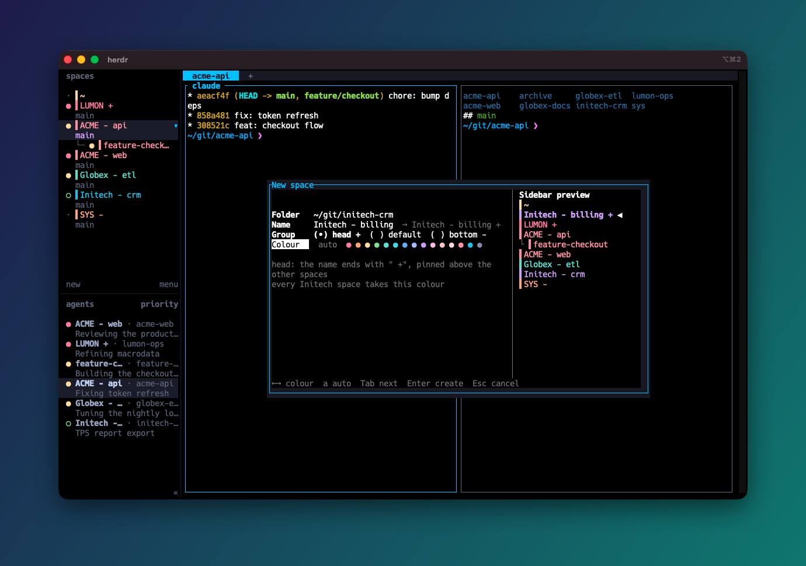

# Space Herder

Herds Herdr's spaces sidebar: keeps it sorted into groups, gives every space of one customer the
same colour, and replaces Herdr's new-space and rename prompts with dialogs that show the result
as you type.


Name your spaces `CUSTOMER - project`, end the ones you always want on top with ` +` and the
parking lot with ` -`. On the right, `~` comes first, `Initech - billing +` and `LUMON +` sit on
top, every `ACME` space is blue and next to the others, worktree included, and `SYS -` waits at
the bottom (Catppuccin palette, sticky mode).

- **A sidebar that sorts itself:** `~` first, then the ` +` head group, plain names and the ` -`
  bottom group, each in name order. On a key, or by itself when a space is created or renamed.
- **A colour per customer:** the same colour on every machine, or in sticky mode the least-used
  one, so customers stay apart. 15 colours from nine preset palettes, or your own.
- **[Dialogs](#dialogs)** to create and rename spaces with a live preview of the sorted, coloured
  sidebar, and to pick a customer's colour yourself.

<br clear="right">


## Install

1. Install the plugin:

   ```bash
   herdr plugin install MrBogomips/herdr-tools/space-herder
   ```

2. Optionally create `config.json` (see [Configuration](#configuration)): `"auto_sort": "both"`
   sorts the sidebar after every new or renamed space, and `"assign": "sticky"` keeps customers'
   colours apart. Without a config the sidebar sorts on a key only, with the Catppuccin palette.
3. Generate the sidebar rows:

   ```bash
   herdr plugin action invoke mrbogomips.space-herder.snippet
   ```

   It writes `sidebar-rows.toml` next to `config.json` and shows the path in a toast.
4. In `~/.config/herdr/config.toml`, set `rows` of your `[ui.sidebar.spaces]` table to the value
   from that file (see [Sidebar rows](#sidebar-rows)), and add the [key bindings](#key-bindings).
5. Check, then reload:

   ```bash
   herdr config check && herdr server reload-config
   ```

### Key bindings

Bind the sort and the two dialogs, and move Herdr's own new-space and rename prompts to other keys
so they stay reachable:

```toml
[keys]
new_workspace = "prefix+ctrl+n"    # Herdr's own prompts, still reachable
rename_workspace = "prefix+ctrl+w"

[[keys.command]]
key = "prefix+shift+s"
type = "plugin_action"
command = "mrbogomips.space-herder.sort"
description = "sort the sidebar: ~, head (+), default, bottom (-)"

[[keys.command]]
key = "prefix+shift+n"
type = "plugin_action"
command = "mrbogomips.space-herder.new-space"
description = "new space: folder, name, group, colour"

[[keys.command]]
key = "prefix+shift+w"
type = "plugin_action"
command = "mrbogomips.space-herder.rename-space"
description = "rename space: name, group, colour"
```

The other actions, `recolor`, `snippet` and `clear`, can be bound the same way or run with
`herdr plugin action invoke mrbogomips.space-herder.<action>`.

### Sidebar rows

The rows replace the built-in `workspace` token of the first space row with one token per colour
(`$spc0`, `$spc1`, …), each with its own foreground:

```toml
[ui.sidebar.spaces]
rows = [
  [
    "state_icon",
    { token = "$spc0", fg = "#f38ba8" },
    { token = "$spc1", fg = "#fab387" },
    # … one entry per colour
  ],
  ["branch", "git_status"],
]
```

The plugin writes each space's name into exactly one of those tokens, so the name shows in its
colour; Herdr hides the empty ones. Keep the table's other keys, such as `row_gap`; add the table
if you have none. **Never paste a second `[ui.sidebar.spaces]` table**: a duplicate table makes
the whole config invalid and Herdr falls back to its defaults, key bindings included.

**Generate the rows again after changing the palette, `palette_size` or a rule's colour**, since
the colours live in `config.toml`. The first comment line carries a fingerprint of the colours, so
you can tell whether the rows in your config are current.

## Groups

A suffix in the space name chooses its group. Groups are sorted in this order, and inside each
group spaces sort by name with the suffix removed, ignoring case:

| Group | Name convention | Example |
| --- | --- | --- |
| home | the name `~` | `~` (always first) |
| head | ends with a space and `+` | `LUMON +` |
| default | no suffix | `ACME - api` |
| bottom | ends with a space and `-` | `SYS -` |

The space before the suffix is required, so names like `C++` or `ACME - api` stay in the default
group. Worktree children follow their parent's group and sit right under it. To move a space,
rename it (for example to `LUMON +`), or pick its group in the [rename dialog](#dialogs); with
autosort on it moves at once, otherwise press the sort key.

Herdr has no sort setting for spaces: they keep the order you give them by dragging. The plugin
reorders all spaces at once with the socket method `workspace.move_block`. The focused space stays
focused, and sorting a sorted list changes nothing. Space numbers and next/previous-space
navigation follow the new order. The sort key reports its result as a toast: "Spaces sorted",
"Spaces already sorted", or "Space sort failed" with the reason.

### Autosort

Autosort is off until you turn it on with `auto_sort` in `config.json`:

| `auto_sort` | Sorts after |
| --- | --- |
| `"off"` (default) | nothing: only the sort key sorts |
| `"created"` | a space is created (including a new worktree space) |
| `"renamed"` | a space is renamed |
| `"both"` | either |

A space nobody named shows its folder name; following its folder with `cd` is not a rename, so it
does not trigger a sort.

## How the colour is chosen

1. **Rules first.** Each rule is a regular expression matched against the space name; the first
   one that matches picks the colour.
2. **Then a colour chosen in a dialog.** The [new-space and rename dialogs](#dialogs) can give a
   key a palette colour of your choice.
3. **Otherwise the key's colour.** The key is part of the name, by default the text before the
   first `" -"` (`ACME - api` → `ACME`). Two ways to turn it into a colour (`assign`):
   - `"hash"` (default): a stable hash (SHA-256) of the key picks a palette colour. The same
     customer gets the same colour on every machine, with nothing stored.
   - `"sticky"`: a new key starts from its hash colour but takes the least-used colour instead
     when that one is taken, and keeps it from then on. No two customers share a colour until
     there are more customers than colours.
4. **Worktree children** take their parent's colour, so a repo's checkouts match it.

Before the key is taken, the name is normalized: whitespace runs count as one space, case is
ignored, and the group suffixes ` +` / ` -` at the end are dropped, so `ACME +` and `ACME - api`
share a colour.

With hashing, two customers share a colour more often than intuition says: with 15 colours, the
odds that some pair of 6 customers clashes are about 2 in 3. Use `"assign": "sticky"`, or pin a
customer to a colour with a rule.

## Dialogs

Herdr's own "new space" and "rename space" prompts ask only for a name. The plugin's dialogs open
in a popup and show the result while you type: the name with its group suffix, and the sidebar as
it will look, with the space in its place and in its colour.



| Field | Keys | What it does |
| --- | --- | --- |
| Folder (new space only) | type, `Tab` completes, `↑` `↓` pick a suggestion | Where the space starts. It opens on the folder of the focused pane; suggestions are the folders you used in this dialog, the folders of open panes and, when [zoxide](https://github.com/ajeetdsouza/zoxide) is installed, its best-ranked ones |
| Name | type, `Backspace`, `Ctrl+W`, `Ctrl+U` | Empty for a new space: Herdr names it after the folder. Ending it with ` +` or ` -` picks the group |
| Group | `←` `→`, `+` `-` `=` | head (` +`), default, or bottom (` -`), see [Groups](#groups). The name `~` is the home space, always first |
| Colour | `←` `→`, `a` for auto | A palette colour for **every space of the key** (`ACME` for `ACME - api`), or auto for the hash or sticky colour |

`Tab` and `Shift+Tab` move between fields (in Folder, `Tab` first completes the path, or lists
the matching folders when there are several), `Enter` creates or renames, `Esc` cancels. A pasted
path is typed in as is: its newline doesn't submit the form. Rename works on the space the key was
pressed in. Bind the dialogs as shown in [Key bindings](#key-bindings).

With `"auto_sort": "both"` the new or renamed space moves to the place shown at once; otherwise
press the sort key.

### Chosen colours


A colour picked in a dialog is saved for the key in `overrides.json` in the plugin state directory
and kept until you set the key back to auto. It beats the hash and sticky colours, and in sticky
mode new customers avoid it; a rule still beats it, so when a rule matches the name the Colour
field shows the rule instead. Worktree children follow their parent and can't pick a colour. Only
palette colours can be picked, since each colour needs its own row slot in `config.toml`; a saved
colour that leaves the palette is ignored.

## Configuration

`config.json` lives in the plugin's config directory (`herdr plugin config-dir
mrbogomips.space-herder`). Every key is optional; an unknown key is an error.
[config.example.json](config.example.json) uses all of them:

```json
{
  "auto_sort": "both",
  "palette": "dracula",
  "palette_size": 13,
  "assign": "sticky",
  "key": "prefix",
  "separator": " -",
  "ignore_case": true,
  "ignore_suffixes": [" +", " -"],
  "marker": "▌",
  "worktrees_follow_parent": true,
  "rules": [
    {"match": "^~$", "color": null},
    {"match": "^Lumon\\b", "color": "#e0e0e0"},
    {"match": "^Initech\\b", "color": 4}
  ]
}
```

| Key | Default | Meaning |
| --- | --- | --- |
| `auto_sort` | `"off"` | When the hooks sort the sidebar: `"off"`, `"created"`, `"renamed"` or `"both"`, see [Autosort](#autosort) |
| `palette` | `"catppuccin"` | A preset name, or your own list of `#RGB` / `#RRGGBB` colours |
| `palette_size` | `null` (all) | Use only the first N colours of the palette, to leave slots for rule colours |
| `assign` | `"hash"` | `"hash"` or `"sticky"`, see [How the colour is chosen](#how-the-colour-is-chosen) |
| `key` | `"prefix"` | What picks the colour: `"prefix"` (before the first separator), `"suffix"` (after the last), or `"whole"` |
| `separator` | `" -"` | Splits prefix from suffix. A name without it, or with an empty side, uses the whole name |
| `ignore_case` | `true` | `ACME` and `acme` share a colour; rules match ignoring case too |
| `ignore_suffixes` | `[" +", " -"]` | Endings dropped before the key is taken (the group suffixes) |
| `marker` | `"▌"` | Drawn before the name in the same colour, as a swatch. `""` for none, `"● "` for a dot |
| `worktrees_follow_parent` | `true` | Worktree children use their parent's colour |
| `rules` | `[]` | `{"match": "<regex>", "color": ...}`, checked in order before the key's colour |

A rule's `color` is a hex colour, a palette index (`0` is the first colour), or `null` for the
default text colour. Regular expressions use Python syntax and match anywhere in the name; anchor
them with `^` and `$`.

**Slots.** A sidebar row holds 16 tokens and the agent-state dot takes one, so 15 colours fit.
The palette uses one slot per colour; a rule colour that is not in the palette takes one more, and
`null` takes one for all such rules. Most presets already use 14 or 15 slots, so to add rule
colours or `null`, lower `palette_size` (the example keeps 13 Dracula colours for one extra
colour and `null`). Rules that use palette colours or indices need no slot. The error message
says how far to lower it.

The config is read on every run, so `auto_sort` changes apply at once. After changing colours, run
`herdr plugin action invoke mrbogomips.space-herder.recolor`, and generate the sidebar rows again
if the palette or a rule's colour changed.

### Sticky assignments

Sticky mode remembers each key's colour in `assignments.json` in the plugin state directory
(`~/.local/state/herdr/plugins/mrbogomips.space-herder/`). Palette colours that rules pin to open
spaces count as taken, so a new customer avoids them too. A key not seen for 90 days is forgotten,
so the folder names of unnamed spaces do not pile up. A remembered colour that is no longer in the
palette is assigned again. Delete the file to deal the colours afresh.

## Palettes

Accent colours of popular themes. Themes with extra shades of their own (bright and dim variants,
secondary accents) use them, up to the 15 colours a row can hold; the most distinct colours come
first, so a smaller `palette_size` keeps those. `python3 space_herder.py palettes` prints them.

| Preset | Colours |
| --- | --- |
| `catppuccin` (Mocha) | 15 |
| `github-dark` | 15 |
| `gruvbox` (dark) | 15 |
| `kanagawa` (Wave) | 15 |
| `tokyo-night` | 15 |
| `dracula` | 14 |
| `nord` | 9 |
| `one-dark` | 8 |
| `solarized` | 8 |

## When it runs

| Hook | Recolours | Sorts | Why |
| --- | --- | --- | --- |
| startup | yes | no | Herdr does not keep plugin tokens across a server restart |
| `workspace.created` | yes | when `auto_sort` is `"created"` or `"both"` | a new space gets its colour and its place |
| `workspace.renamed` | yes | when `auto_sort` is `"renamed"` or `"both"` | a renamed space gets its colour and its place |
| `workspace.updated` | yes | no | a space joins or leaves a worktree group |
| `pane.focused` | yes | no | a space nobody named shows its folder, and a `cd` changes it with no event a plugin can hook; the name catches up at the next focus change |

Every run compares the wanted tokens with the current ones and writes only the difference, so the
frequent focus hook costs one `workspace.list` call when nothing changed. If spaces are created or
closed while a sort runs, the sort starts over, up to three times, before it reports a failure.

Hooks are silent when they work. The colour and the sort run apart, so a failed recolour still
sorts. When a hook fails, a toast says why; the same failure toasts again only after 10 minutes,
and every run's output and errors are in `herdr plugin log list --plugin mrbogomips.space-herder`.

## Limits

- **No background colour.** Herdr styles a token's foreground, bold and dim only: "token styles
  never change separators or row backgrounds". The marker before the name stands in for a swatch.
- At most 15 colours, the tokens one sidebar row can hold next to the agent-state dot.
- The colours show in the expanded sidebar. The collapsed rail and the mobile layout keep
  Herdr's own rendering.
- The plugin now shows the space names. If it is disabled while its rows are in `config.toml`,
  the first row loses its name; restore the default rows (see [Uninstall](#uninstall)).
- `ACME-api` does not split on `" -"`; keep the space before the dash, or change `separator`.
- `▌` is drawn one column wide by most terminals; if yours shows a gap or overlap, pick another
  `marker`.
- The dialogs replace Herdr's prompts only on the keys you bind; other ways to create or rename a
  space keep Herdr's own behaviour.
- The dialog's preview shows where the sort puts the space, not where Herdr puts it before sorting.
- A space dragged by hand goes back to its group at the next sort.

## Uninstall

1. Set `rows` of `[ui.sidebar.spaces]` back to the default,
   `[["state_icon", "workspace"], ["branch", "git_status"]]` (or remove the key), then run
   `herdr config check && herdr server reload-config`.
2. `herdr plugin uninstall mrbogomips.space-herder`. Its tokens are gone after the next server
   restart; the default rows do not show them meanwhile.

## Command line

From a terminal inside Herdr, in the plugin folder:

```bash
python3 space_herder.py sort --dry-run   # print the current and the target order only
python3 space_herder.py sort             # sort now
python3 space_herder.py preview          # each space: key, slot, colour, and why; writes nothing
python3 space_herder.py                  # colour every space now (same as "recolor")
python3 space_herder.py snippet          # print the sidebar rows
python3 space_herder.py snippet --write  # write them to sidebar-rows.toml next to config.json
python3 space_herder.py clear            # remove the plugin's tokens (hooks add them back)
python3 space_herder.py palettes         # list the presets
python3 space_dialog.py run new          # the new-space dialog in this terminal
python3 space_dialog.py run rename       # rename the space in $SPACE_HERDER_WORKSPACE_ID
```

`--config PATH` reads another config file. The scripts talk to `$HERDR_SOCKET_PATH` (set inside
Herdr panes, key commands and plugins), falling back to `~/.config/herdr/herdr.sock`.

## Tests

```bash
cd space-herder && python3 -m unittest -v
```
